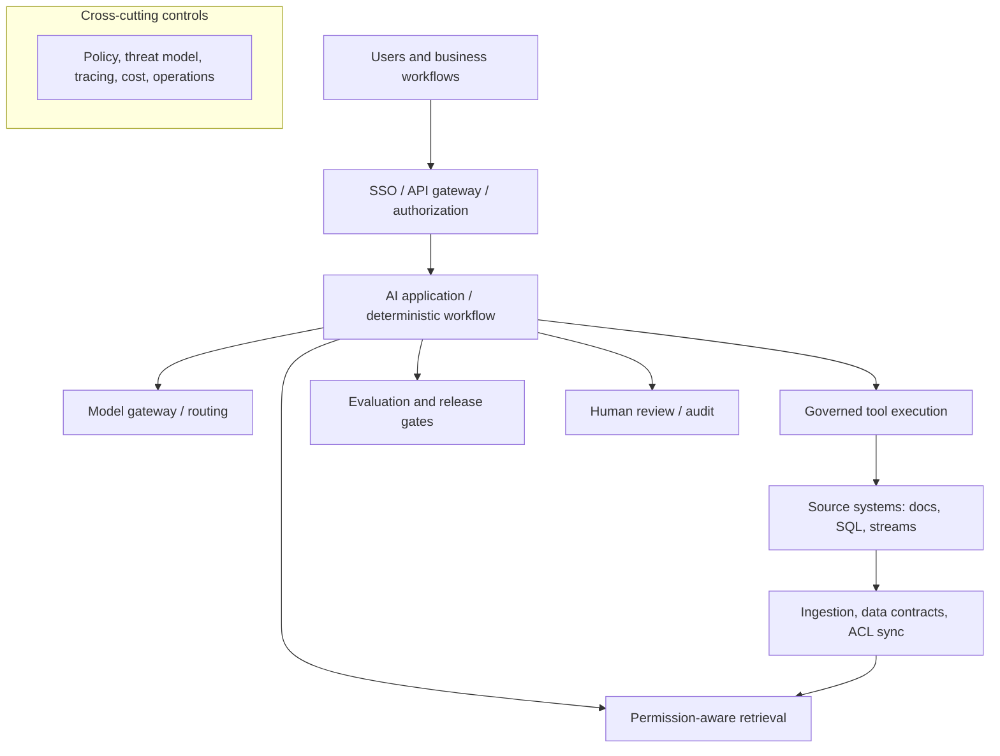

# Enterprise AI reference architecture (illustrative)

This is a **logical** diagram, not a claim of one universal reference solution. For classification, fraud scoring or edge AI the retrieval layer may be omitted; for high-risk actions use a separate policy and transaction execution service with bounded privileges.

## Design review checklist
- Business baseline, critical risks and outcome owner identified?
- Trusted identity, authorization, privacy and data location established?
- Model and retrieval access constrained? No untrusted data promoted to instructions?
- Durable state, recovery and unknown external outcomes modeled?
- Evaluation oracle and severity-weighted error criteria agreed?
- Monitoring, rollbacks, fallback modes and incident commander identified?
- Human approvals, auditability and policy exception process explicit?
