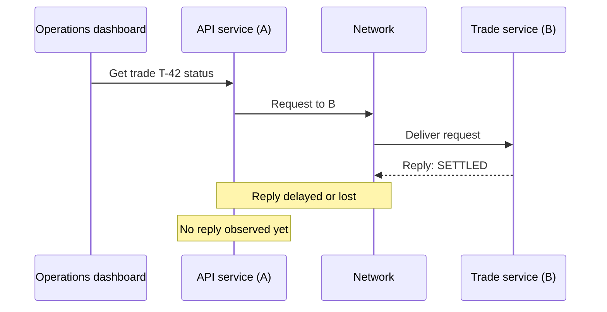

# Domain 20 · Module 01 — Distributed-system fundamentals

**State:** Teaching started 2026-10-24; **not yet assessed / not mastered**.

**Navigation:** [Domain 20](../README.md) · [Ten-module roadmap](../MODULE-ROADMAP.md) · [Chat-first protocol](../../../../00-start-here/CHAT-FIRST-WORKFLOW.md)

## Why we are starting here

Many AI architectures are distributed before they are 'agentic': a chat frontend talks to a backend, which talks to a model provider, retrieval service, identity service, workflow engine and bank systems. A correct algorithm within one process does not eliminate uncertainty at a network or service boundary.

**Driving question:** If Service A did not receive a reply from Service B, what exactly can A conclude about B?

We will not start with Kafka offsets or Saga code. We will first build a precise model of independent actors and partial failure.

## What to know before this module

- Basic idea of an application, process, API, database and network.
- No advanced mathematics required.
- If these terms are unfamiliar, clarify them in conversation before going further.

## Six micro-lessons (one at a time)

| ID | Micro-topic | Status |
|---|---|---|
| 1.1 | What makes a system distributed? Processes and boundaries | **Start here — interactive explanation** |
| 1.2 | Why distribute? Scaling, independent deployment, fault domains | Planned |
| 1.3 | Requests, messages and events; sync vs async | Planned |
| 1.4 | Partial failure and the limits of observations | Planned |
| 1.5 | Clocks, time and ordering across machines | Planned |
| 1.6 | Correctness invariants and system guarantees | Planned |

## Micro-lesson 1.1 — What makes a system distributed?

### Intuition

A program running all its logic in one process can often directly observe its own memory and errors. The moment it depends on another independently running process or machine over a network, the first process cannot directly read the other's live state. It sends messages and infers what may have happened from observations.

That creates a new class of uncertainty: a remote service can finish its work but its reply can be delayed or lost.

### Tiny enterprise example (invented, for teaching)

A banking operations dashboard calls an API gateway. The gateway calls a Trade Service for the current status of trade T-42:

**Facts:** B processed the request and created a reply in the illustrated trace. **Observation at A:** no reply has arrived. **Invalid conclusion:** 'B definitely crashed' or 'the trade must not exist'. Real services may be up while communication is down; and a missing response alone does not prove B's current state.

This example is a *read* request so we can first understand observation and failure. Later modules extend this to irreversible *writes*, where blind retries can be dangerous.

### Contrast: one local process vs two services

| Question | Local call (same process) | Remote call (different processes / network) |
|---|---|---|
| Is there a network hop? | Not for the call itself | Usually yes |
| Can network failure interrupt the call? | No network hop in this call | Yes |
| Can the caller directly inspect callee memory? | Often within same process | Generally no |
| Does a caller-side timeout prove remote execution failed? | Not applicable in the same way | **No** |

**Analogy limit:** A distributed system can also run multiple processes on one machine, communicating through local IPC; different physical machines are not the defining requirement. The defining feature is independent components communicating without sharing a single reliably observable state.

### Enterprise connection

An AI trade-investigation agent might call a case store, policy retrieval service and ledger API. An agent's confident interpretation does not establish a ledger write happened or did not happen. The architecture needs durable observations, reconciliation mechanisms and action limits. We will explore those in Modules 02–09.

### Questions to discuss live

1. Two services live on the same machine but run as separate processes and communicate over sockets. Is that distributed? Explain your criteria.
2. Service A sees no reply for three seconds. Enumerate several distinct possible causes, and identify which ones A can distinguish using only that observation.
3. Would your design change if B performed a balance transfer rather than reading a trade status?

**Current teaching checkpoint:** Begin by answering Question 1 or 2 in conversation. Don't read an answer key first. The tutor should adapt the next explanation to the learner's response.

## Exit evidence for Module 01

- Explain process, machine, network and remote observation in your own words.
- Annotate a sequence diagram with observed facts, possible but unverified states, and invariant.
- Diagnose a novel partial-failure scenario, distinguishing what is known from what is merely plausible.
- Draw one trade-operation example with an independently supported correctness property.
- Link one independently checked source or trace; mark any experiment as simulated.

## Reading resources

- [AWS Builders' Library: Timeouts, retries, and backoff with jitter](https://aws.amazon.com/builders-library/timeouts-retries-and-backoff-with-jitter/) — preview; deep timeouts are Module 02.
- [Designing Data-Intensive Applications](https://dataintensive.net/) — background for networked data systems and coordination.
- [Domain roadmap](../MODULE-ROADMAP.md) — the rest of D20.
- [Worked example: unknown outcomes](../../../../04-worked-lessons/unknown-outcome-and-idempotency.md) — later extension, not prerequisite.

**Editorial status:** Initial teaching handout only. Future `lessons/` files will contain polished explanations produced *after* interactive learning and independent review. No learner answer or mastery evidence has yet been recorded.
