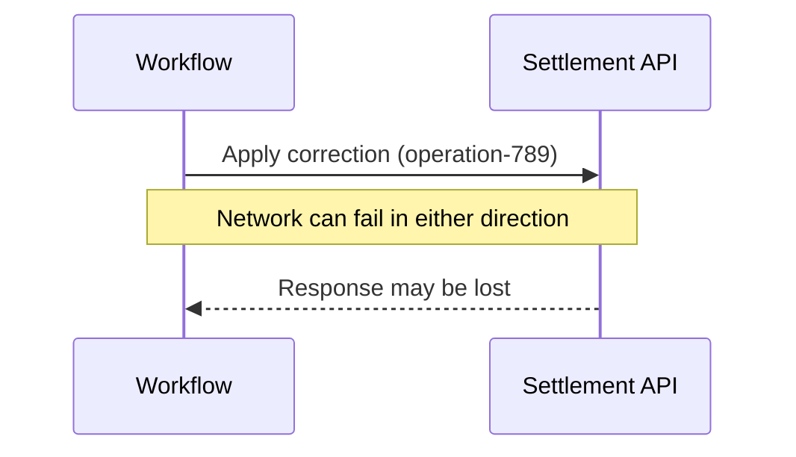
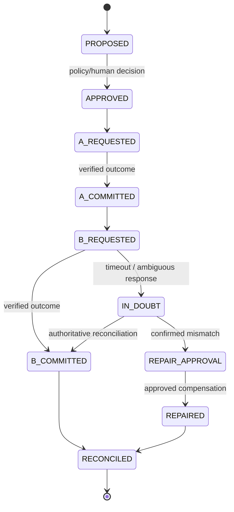

# Distributed transactions: the unknown-outcome problem

**Relevant domains:** D14, D15, D20, D25 · **One skill:** never confuse an API response with the business state of an external system.

## 1. The puzzle
An approved AI-led trade correction needs updates to independent Systems A and B. A reports success. A request to B times out after 10 seconds. Kafka redelivers the original event.

Can the orchestrator safely repeat the whole workflow? **Not without understanding the operation contract.**

## 2. Three distinct events that look like 'timeout'
Imagine a client invokes `POST /settlement/corrections`.



| Possibility | Actual external effect | What client observed | Safe to assume? |
| --- | --- | --- | --- |
| Request never reached B | No commit | Timeout | No: observation doesn't prove this branch |
| B received request and failed before commit | No commit | Timeout | No: cannot distinguish from next branch |
| B committed, response was lost | One commit | Timeout | No: retry might cause second effect |

**Therefore:** a timeout means the result is **unknown**, not definitively failed.

## 3. The idempotency contract
An operation is idempotent if repeating the *same intended operation* does not cause an additional business effect. HTTP method choice or attaching a key alone does not create this property.

A robust API can accept a client-generated `operation_id`, atomically persist the identifier and outcome with the business update, and return the original result on repeat requests with the *same intent*. It must reject or flag key reuse with different payloads.

```text
Event E-77 = one economic correction
Operation key K = stable, deterministic from E-77 plus correction revision
System A accepts K; committed
System B accepts K; timeout
Replay event E-77:
  consult durable state and authoritative outcome
  retry B with SAME K only IF B truly enforces idempotency
  never create a fresh K for the same correction
```

Deduplicating Kafka messages in the consumer is helpful but does not prove exactly-once effects in independent external databases. A crash can happen after the external effect but before the consumer records success.

## 4. Durable workflow state machine


Keep durable workflow history, the stable business operation ID, per-system state, input hash, authorization decision, approval evidence, retry/compensation history and audit trail. Use concurrency control so two workers can't concurrently run the same correction.

## 5. The difficult variant: B has no idempotency key AND no status API
This is where the architecture has to become conservative.

What **not** to do:
- Blindly retry B: it may already have committed.
- Blindly roll back A: rollback may be non-atomic, illegal or inconsistent with a B commit.
- Trust the AI's explanation that B 'probably failed'.
- Claim software can guarantee exactly-once effects against a black-box non-idempotent API.

What to do:
1. Durably record `B_OUTCOME_UNKNOWN` and block further automated action on the trade.
2. Preserve evidence: operation payload, timestamp, request IDs, logs, audit, approval and current visible state.
3. Try an **independent authoritative reconciliation channel**, where permissible: settlement report, operations journal, overnight balances, audit feed or controlled inquiry—even if B's own API cannot return the operation status.
4. If no trustworthy channel exists, escalate for authorized human investigation and document uncertainty. Do **not** fabricate a certain outcome.
5. Only after state is established, choose a safe continuation or approved compensating transaction.
6. Redesign B's integration contract or build a controlled gateway for future work. A local gateway can't guarantee exactly-once effects if the ultimate external service remains an opaque non-idempotent system.

## 6. Saga versus distributed atomic transaction
Systems A and B cannot share a database transaction in this exercise. A **saga** coordinates independent local transactions with explicit compensation on failure. Compensation is a *new business action* (e.g. cancel/amend) rather than time travel that erases all external observations.

**Important:** compensation may be impossible, unsafe or prohibited after certain financial settlement events. Determine compensability with domain owners, and require human review where appropriate.

## 7. Transactional outbox, inbox and Kafka
An outbox can atomically persist a local database change and the intention to publish an event. The dispatcher may send an event more than once, so consumers need deduplication/idempotent handling. An inbox tracks previously consumed event IDs. These patterns improve local consistency and reliable publishing; they **do not magically make B's non-idempotent side effect exactly once**.

### Business invariant
For each authorized correction ID: no unexplained duplicate economic corrections, every system's status is reconciled or durably marked in-doubt, and any compensating adjustment is approved and audited.

## 8. Simulated failure laboratory
Have an AI coding agent create two lightweight stateful APIs and a Kafka-like duplicate event generator (synthetic only). Run:

1. A commits; B rejects before commit.
2. B commits; response is dropped.
3. Event is delivered twice concurrently.
4. Worker crashes after B commits but before persisting success.
5. B is deliberately configured with no idempotency and no status endpoint.

Before running each, write down predicted final balances/state and whether safe automation is possible. Instrument execution IDs and compare with an independent simulated transaction ledger. Stop on unknown outcomes rather than guessing.

## 9. Architecture interview exercise
CTO: 'Our vendor's API has no operation ID or read-after-write access. We must never double-correct a trade. Can you guarantee full automation?'

Strong response: 'Not under the stated interface. We can guarantee our own workflow won't intentionally repeat a known completed action, but we cannot prove the external economic outcome after a lost response. I will require an authoritative reconciliation route, revised vendor contract, or human-controlled in-doubt process before extending autonomy. I will not promise exactly-once behavior we cannot verify.'

## Sources
- [Amazon Builders' Library — Making retries safe with idempotent APIs](https://aws.amazon.com/builders-library/making-retries-safe-with-idempotent-APIs/)
- [Temporal workflow execution](https://docs.temporal.io/workflows)
- [Kafka documentation](https://kafka.apache.org/documentation/)
