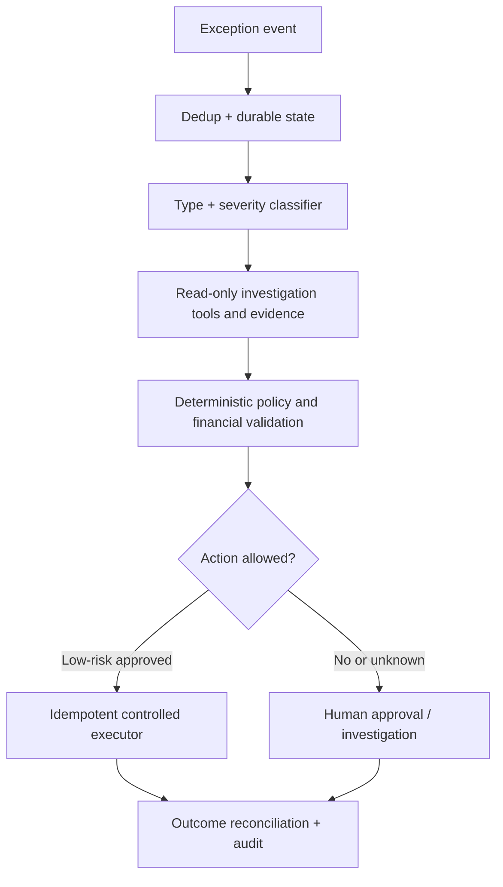

# Case study — Autonomous trade exception investigation

## Executive request
200,000 trades/day, approximately 2,000 exceptions, 60 manual investigators, proposed 70% automation. Wrong corrections may cause financial loss.

## Discovery
Inventory exception types, volumes, handling times, mandatory approvals, sources of truth and historic resolutions. Separate automation of **cases** from automation of **staff hours**. Find what can be resolved via deterministic rules.

## Logical design

## Key architecture decisions
- Constrain AI to proposing investigations and structured corrective plans; deterministic code enforces entitlement, invariants, action limits and execution.
- A high model confidence number is not a sufficient authorization criterion.
- Require idempotency, concurrency controls, durable state and reconciliation. Unknown external outcomes require safe suspension, not blind retries.
- Use AI coding agents after threat and failure analysis to build synthetic test harnesses.

## Proof of success
Run read-only shadow mode on historical and live examples; evaluate resolution correctness per exception type and severity, financial reversals, time savings, user review rates, failed and duplicated actions. Escalate or defer high-risk cases. Expand autonomy by documented policy and evidence.
