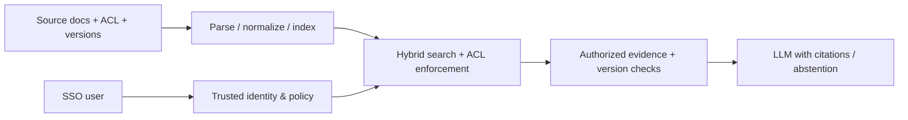

# Case study — 50,000-document enterprise knowledge assistant

## Executive request
Employees waste time searching across policies, operations manuals and compliance documentation. Some documents are restricted; content changes frequently.

## First questions
How is wasted time measured? Which questions are highest-value? What source systems and existing access policies apply? What does wrong policy advice cost? What freshness and latency are necessary? What existing search system could be extended?

## Architect the minimum viable system

## Risks to challenge
- Permissions must apply **before unauthorized text reaches model context**; consider stale ACLs and cache key isolation.
- Effective-date filtering and authoritative source conflict resolution matter beyond vector similarity.
- Source deletions and permission revocations require timely invalidation.
- A second LLM's confidence is not a calibrated factual guarantee.

## Evaluation
Separately test retrieval recall, answer correctness, citation support, denial of unauthorized data, ingestion freshness, p95/p99 latency, and measured user search time. Use expert-validated holdouts and permission adversarial tests. Launch criteria are jointly accepted by business, security and operational owners.

## Interview follow-ups
Why not a multi-agent architecture? How can one vector index be shared securely? What if legal policy changes immediately but indexing is delayed? What if a compliant user queries a document that has just been reclassified?
